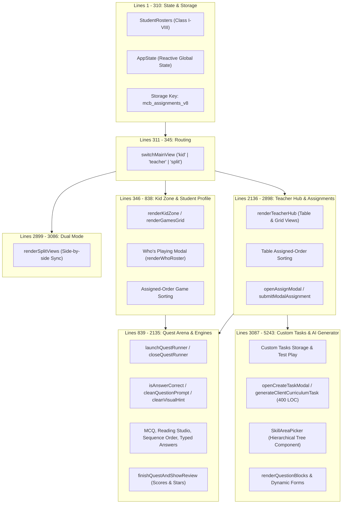
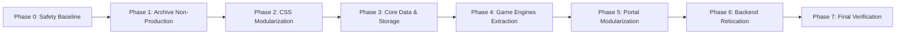

# 🏛️ MyClassboard (MCB) Games Platform — Comprehensive Reorganization Plan

> **Status:** Phases 0 through 7 COMPLETE — Full Modular Architecture Established (Zero Behavior Regressions).  
> **Target Version:** Clean, Modular, Scalable Architecture (Zero Behavior Changes)  
> **Preserved Invariants:** `localStorage` key `'mcb_assignments_v8'`, all 440 learning outcomes (`LO-001` to `LO-440`), zero answer/formula leaks, authentic curriculum taxonomy, no-build-step runtime.

---

## Executive Summary

The MyClassboard (MCB) Games Platform is a feature-rich, curriculum-mapped educational web application for Classes I–VIII. While the application currently delivers strong pedagogical value and visual appeal, its codebase has accumulated significant architectural debt:
- **`js/app.js` is 5,304 lines** containing state, rosters, view routing, kid games, quest runners, teacher tables, assignment modals, and an entire 400-line client AI generator.
- **`css/styles.css` is 5,488 lines** combining tokens, resets, three distinct portals, multiple modals, and animations.
- **The root directory contains 40 loose files**, mixing backend Python files, database migration scripts, redirect stubs, and multi-megabyte data files.
- **`tools/` contains 56 scripts**, blending critical content-auditing suites with obsolete one-off patch scripts.

This document details an audit of the repository, a proposed target structure, a risk-mitigated phased migration plan, and housekeeping standards.

### Implementation record (2026-10-28)

- **Phase 0 complete:** `tools/verify_all.py` runs the active critical-content, clean-formatting, assigned-order, and diorama checks from the project root. All suites pass 100%.
- **Phase 1 complete:** Internal scratch workspace archived to `archive/scratch/`. One-off historical patch scripts archived to `tools/archive/`.
- **Phase 2 complete:** `css/styles.css` modularized into 13 structured component layers under `css/base/`, `css/components/`, `css/portals/`, `css/quest/`, and `css/authoring/` via clean `@import` cascade.
- **Phase 3 complete:** `StudentRosters`, `AppState`, assignment persistence (`mcb_assignments_v8`), reset/assignment operations, and toast notifications modularized into `js/core/` (`namespace.js`, `rosters.js`, `state.js`, `storage.js`, `catalog.js`).
- **Phase 4 complete:** Quest Runner lifecycle, answer evaluators, reading studio, sequence ordering, and score review screens modularized into `js/quest/runner.js`.
- **Phase 5 complete:** Portal views and authoring engines modularized into `js/portals/kid-zone.js`, `js/portals/teacher-hub.js`, `js/portals/split-view.js`, and `js/authoring/tasks.js`. Main `js/app.js` reduced to a lean bootstrap orchestration script (~3 KB).
- **Phase 6 complete:** Backend relocated into `backend/` with sub-packages `backend/routes/` and `backend/services/`. Offline content generation scripts consolidated in `tools/pipeline/`. Root compatibility shims preserve seamless execution of `python app.py` and `npm run dev`.
- **Phase 7 complete:** All verification suites in `tools/verify_all.py` passing, all 14 JS modules syntax-verified with Node, and cache busters bumped to `?v=6.0` across `index.html`.

---

## Step 1 — Architectural Audit (Read-Only)

### 1.1 Full Directory Inventory & File Purpose

```
c:\Projects\Games (5)\Games\
├── .claude/
│   └── settings.local.json          # Tool and agent workspace configuration
├── .env                             # Environment configuration (DB credentials, API keys)
├── .env.example                     # Environment template for deployment
├── .gitignore                       # Git ignore list
├── .htaccess                        # Apache server configuration & MIME mappings
├── README.md                        # Project documentation
├── RUN_SETUP.bat                    # One-click Windows startup script
│
├── Root Application & Data:
│   ├── index.html                   # Active Single Page Application (Kid Zone, Teacher Hub, Split View)
│   ├── full_games_catalog.js        # Authoritative catalog of all 440 games & questions (2.18 MB)
│   ├── full_games_catalog.json      # JSON mirror of the 440-game catalog (2.18 MB)
│   ├── question_bank.js             # Legacy question bank bundle (1.0 MB)
│   ├── curriculum-data.js           # Supplementary curriculum mappings (48 KB)
│   ├── curriculum_catalog.json      # Supplementary curriculum catalog (31 KB)
│   ├── skill_areas_data.json        # Sub-skill taxonomy tree for Classes I-VIII (183 KB)
│   ├── package.json                 # Node dependencies and npm scripts
│   ├── package-lock.json            # Pinned dependency tree
│   └── requirements.txt             # Python dependencies (Flask, SQLAlchemy, psycopg2)
│
├── Root Standalone / Stub HTML:
│   ├── portal.html                  # 183-byte redirect stub (`location.replace('index.html')`)
│   ├── teacher-portal.html          # 183-byte redirect stub (`location.replace('index.html')`)
│   ├── play.html                    # Legacy standalone game player page (39 KB)
│   ├── exam.html                    # Legacy standalone exam portal (17 KB)
│   └── data-graphs.html             # Standalone Chart.js analytics demo (25 KB)
│
├── Root Backend & Generation Scripts:
│   ├── app.py                       # Flask REST server & route controller
│   ├── models.py                    # SQLAlchemy database models
│   ├── ai_helper.py                 # Gemini AI integration for question generation
│   ├── ai_cache.py                  # Local cache for AI-generated prompts and games
│   ├── assignment_routes.py         # Flask Blueprint for assignment endpoints
│   ├── scoring_routes.py            # Flask Blueprint for scoring endpoints
│   ├── scoring_system.py            # Scoring business logic and grade calculation
│   ├── setup_database.py            # DB initialization script
│   ├── games_data.py                # Python representation of games data
│   ├── listening_content.py         # Python dataset of listening narrations
│   ├── question_content.py          # Python dataset of core questions
│   ├── build_question_bank.py       # Offline script assembling question_bank.js
│   ├── create_class1_media.py       # Class 1 media generation utility
│   ├── generate_class1_audio.py     # Class 1 TTS audio generation utility
│   ├── generate_reading_passages.py # Reading studio passage generation
│   ├── curriculum_reading_passages.py # Passage dataset
│   ├── odd_one_out_build.py         # Odd One Out game builder
│   ├── odd_one_out_content.py       # Odd One Out questions
│   └── odd_pictograms.py            # Visual pictogram data
│
├── audio/ (25 files)                # Synthesized audio narrations (.wav) & index.json
├── content/ (8 files)               # Per-class JS files (class-I.js to class-VIII.js)
├── css/ (4 files)
│   ├── styles.css                   # Primary monolithic stylesheet (5,488 lines)
│   ├── class2_games.css             # Mini-game specific styling (1,240 lines)
│   ├── reading_studio.css           # Reading studio modal styles (380 lines)
│   └── learn_through_play.css       # Legacy play styles
├── curriculum/
│   └── Skill_Areas - Subskill area.pdf # Reference PDF for educational taxonomy
├── data/ (2 files)
│   ├── activity_card_thumbnails.js  # 440 diorama prompts and SVG/JPG paths (1.25 MB)
│   └── activity_card_thumbnails.json# JSON mirror of thumbnails
├── database/ (10 files)
│   ├── CREATE-DATABASE-PRODUCTION.sql # Production PostgreSQL DDL & seeds (450 KB)
│   ├── create_tables.sql            # Basic table schema
│   └── scripts/                     # Python DB setup & table creation scripts
├── docs/ (117 files)                # Design specs, curriculum guides, architecture docs
├── images/ (563 files)              # SVGs, JPG thumbnails, badges, UI assets
├── js/ (4 files)
│   ├── app.js                       # Monolithic application script (5,304 lines)
│   ├── class2_games.js              # Class 2 interactive mini-games engine
│   ├── learning_outcomes_data.js    # Learning outcomes reference dataset
│   └── reading_studio.js            # Reading studio engine
├── legacy/ (63 files)               # Archived dashboards, early prototypes, standalone pages
├── scratch/ (64 files)              # Intermediate development scripts and experimental data
├── scripts/ (1 file)
│   └── open-browser.js              # Dev script to launch browser after Flask startup
├── tools/ (56 files)                # Auditing, validation, content-cleaning scripts
└── videos/ (18 files)               # Class 1 activity video metadata JSON files
```

---

### 1.2 Dead, Duplicate, Backup, or Temporary Files

| File / Folder | Category | Confidence | Recommended Action | Justification |
| :--- | :--- | :--- | :--- | :--- |
| `portal.html` | Redirect Stub | **100% High** | Move to `archive/stubs/` or keep minimal redirect | Contains only `location.replace("index.html")`. Not loaded by users directly. |
| `teacher-portal.html` | Redirect Stub | **100% High** | Move to `archive/stubs/` or keep minimal redirect | Identical 183-byte redirect to `index.html`. |
| `play.html` | Legacy Player | **95% High** | Move to `archive/legacy_pages/` | Superseded by the unified Quest Runner in `index.html`. |
| `exam.html` | Legacy Exam | **95% High** | Move to `archive/legacy_pages/` | Early PIN-based exam prototype; not linked from `index.html`. |
| `data-graphs.html` | Legacy Demo | **95% High** | Move to `archive/legacy_pages/` | Standalone Chart.js prototype. Not linked in active navigation. |
| `question_bank.js` (1.0 MB) | Generated/compatibility data, not presently removable | **100% High** that it is still pipeline input | Retain in place until a manifest-aware pipeline migration | `tools/clean_all_question_leaks.py` rewrites it and `tools/verify_clean_formatting.py`, `tools/validate_bank.py`, and several audits read it. It is not loaded by the active SPA, but it is an active content-quality contract. |
| `curriculum-data.js` (48 KB) | Candidate duplicate / compatibility data | **Medium (60%)** | Retain and document its owner until all references and generation paths are reconciled | It is not loaded by the active SPA, but its overlap with catalog and skill data does not prove it is disposable. |
| `curriculum_catalog.json` | Candidate duplicate / source data | **Medium (60%)** | Retain and document its owner until all generators and deployment workflows are reconciled | It overlaps with the runtime catalog but must be treated as a possible source-of-truth until lineage is explicit. |
| `scratch/` (64 files) | Scratch Scripts | **95% High** | Move to `archive/scratch/` | One-off test scripts (`inspect_flagged_details.py`, `test_shuffle_distribution.py`). |
| One-off scripts in `tools/` (35+ files) | Temporary Fixes | **90% High** | Move to `tools/archive/` | Historical migration scripts (`finish_answer_swap.py`, `repair_mangled.py`, etc.). |
| `css/learn_through_play.css` | Unused Style | **95% High** | Move to `archive/css/` | Not loaded in `index.html`. |
| Root generation scripts (15+ py files) | Misplaced Backend | **100% High** | Move to `backend/content_generators/` | Clutters root; belongs with content pipeline. |

---

### 1.3 `js/app.js` Section Map & Global Dependencies

Current size: **5,304 lines**, **132 functions**, **1 central state object**, **1 roster data object**.



#### Detailed Breakdown:

1. **Lines 1–74: Static Data & Central State**
   - **Data**: `const StudentRosters = { "I": [...], ..., "VIII": [...] }`
   - **State**: `const AppState = { currentView: 'kid', selectedClass: 'IV', selectedSubject: 'all', assignments: [], ... }`
   - **Globals Shared**: `AppState`, `StudentRosters`.
2. **Lines 75–310: Persistence & Global Mutation Operations**
   - **Functions**: `loadSavedAssignments()`, `saveAssignments()`, `promptResetAssignments()`, `clearAllAssignments()`, `unassignActivity(gameId)`, `assignAllStudentsToGame(gameId)`.
   - **Key Dependency**: Operates directly on `AppState.assignments` and `localStorage.getItem('mcb_assignments_v8')`.
3. **Lines 311–345: Portal Routing**
   - **Functions**: `switchMainView(viewName)` (manages DOM visibility for `#kidZoneContainer`, `#teacherHubContainer`, `#splitViewContainer`).
4. **Lines 346–645: Kid Zone / Adventures Grid**
   - **Functions**: `renderKidZone()`, `updateKidStats()`, `renderGamesGrid()`, subject/skill filter change handlers, assigned-order sorter.
5. **Lines 646–838: Student Selection & Profile ("Who's Playing?")**
   - **Functions**: `openWhoIsPlaying()`, `closeWhoModal()`, `renderWhoRoster()`, `selectStudentForMission()`, `startSelectedMission()`.
6. **Lines 839–1045: Quest Runner Framework & Lifecycle**
   - **Functions**: `launchQuestRunner(gameId)`, `closeQuestRunner()`, `toggleQuestFullscreen()`, `toggleQuestSound()`, `launchQuestConfetti()`.
7. **Lines 1046–1668: Step Renderers & Evaluators**
   - **Functions**: `isAnswerCorrect()`, `cleanQuestionPrompt()`, `cleanVisualHint()`, `renderQuestStep()`, `selectReadingMCQAnswer()`, `submitTypedReadingAnswer()`, `renderReadingStudioStep()`.
8. **Lines 1669–1988: Quest Context & Supplementary Practice**
   - **Functions**: `renderQuestContext()`, `toggleContextAudio()`, `renderSequenceOrderPractice()`, `speakCurrentQuestPrompt()`.
9. **Lines 1989–2135: Quest Review & Scoring Screen**
   - **Functions**: `finishQuestAndShowReview()`, `retakeCurrentQuest()`. Updates `AppState.assignments` completion state and triggers `saveAssignments()`.
10. **Lines 2136–2634: Teacher Hub (Table & Grid Views)**
    - **Functions**: `renderTeacherHub()`, `handleTeacherClassChange()`, `updateTeacherSubjectChips()`, `filterTeacherSubject()`, `setTeacherLayoutMode()`. Contains assigned-order sorting for table rows and metric updates.
11. **Lines 2635–2898: Teacher Assignment Modal & Batch Assignment**
    - **Functions**: `openAssignModal()`, `openAssignModalForSkill()`, `openAssignModalForGame()`, `renderAssignStudentsList()`, `submitModalAssignment()`, `unassignSkill()`.
12. **Lines 2899–3086: Split View Engine**
    - **Functions**: `renderSplitViews()`, `toggleSplitTeacherFilter()`. Synchronizes dual teacher and kid columns.
13. **Lines 3087–3637: Custom Tasks & AI Idea Prompts**
    - **Functions**: `loadCustomTasks()`, `saveCustomTasks()`, `loadCustomTasksIntoCatalog()`, `testPlayCreatedGame()`, `applyCurriculumIdea()`.
14. **Lines 3638–4411: Teacher "Create Task" Modal & Offline AI Generator**
    - **Functions**: `openCreateTaskModal()`, `triggerAiTaskGeneration()`, `generateClientCurriculumTask()` (a massive 400-line heuristic question generator).
15. **Lines 4412–4779: Skill Area Hierarchical Picker Component**
    - **Functions**: `openSkillAreaPicker()`, `renderSkillPickerList()`, `filterSkillAreaPicker()`, `selectSkillFromPicker()`.
16. **Lines 4780–5243: Task Form Builders & Delete Modals**
    - **Functions**: `renderQuestionBlocks()`, `addNewQuestionBlock()`, `submitCreateTask()`, `openDeleteTaskModal()`, `executeDeleteCustomTask()`.

---

### 1.4 Dependencies & Load Order in `index.html`

Currently, `index.html` loads 4 scripts synchronously at the bottom of the `<body>`:

```html
<!-- 1. Global Catalog Dataset (defines window.GamesCatalog) -->
<script src="full_games_catalog.js?v=5.6"></script>

<!-- 2. Diorama Thumbnails (defines window.ACTIVITY_CARD_THUMBNAILS) -->
<script src="data/activity_card_thumbnails.js?v=5.6"></script>

<!-- 3. Class 2 Mini-Games Engine (defines window.Class2Games) -->
<script src="js/class2_games.js?v=5.6"></script>

<!-- 4. Monolithic App Logic (relies on 1, 2, 3 being on window) -->
<script src="js/app.js?v=5.6"></script>
```

#### Shared Global Namespace:
- `GamesCatalog`: Array of 440 objects. Read by `renderGamesGrid`, `renderTeacherHub`, `launchQuestRunner`, `openAssignModalForGame`.
- `ACTIVITY_CARD_THUMBNAILS`: Array of 440 diorama prompt records.
- `Class2Games`: Helper object with `isClass2Interactive(game)` and mini-game render hooks.
- `AppState`: Read and mutated by nearly every function in `js/app.js`.
- `StudentRosters`: Read by `renderWhoRoster`, `renderTeacherHub`, `renderAssignStudentsList`, `renderCreateTaskStudentsList`.

---

### 1.5 Code Smells & Splitting Risks

1. **Tight Coupling via Shared Mutation of `AppState`**:
   - `AppState` is modified directly in event handlers (e.g., `AppState.selectedClass = cls; renderTeacherHub();`).
   - *Splitting Risk:* Splitting files without a unified state manager could lead to circular script dependencies or desynchronized UI updates.
2. **HTML Generation via Massive Template Literals**:
   - Complex HTML structures (table rows, modal dialogs, game arena steps) are generated using 50-line inline template strings inside JS functions.
3. **Repeated Logic**:
   - Student roster rendering with checkboxes appears in three separate places:
     - Who's Playing modal (`renderWhoRoster`)
     - Teacher Assign modal (`renderAssignStudentsList`)
     - Teacher Create Task modal (`renderCreateTaskStudentsList`)
   - Question cleaning logic is defined in `cleanQuestionPrompt` in `app.js` and duplicated across multiple `tools/` scripts.
4. **Massive Functions**:
   - `renderTeacherHub()`: ~400 lines
   - `renderQuestStep()`: ~250 lines
   - `generateClientCurriculumTask()`: ~400 lines
   - `renderReadingStudioStep()`: ~200 lines
5. **No Direct Module Scope**:
   - All 132 functions are currently bound to the global `window` scope because HTML attributes use inline handlers like `onclick="previewActivity('LO-096')"` or `onclick="switchMainView('teacher')"`.
   - *Critical Constraint:* Any modularization must either keep these public entry points accessible on `window` or bind them with robust event listeners.

---

### 1.6 Files Outside Clear Structure

- **Root Python Files**: 19 backend and generation scripts reside in the workspace root instead of a dedicated `backend/` directory.
- **Large Data Files in Root**: `full_games_catalog.js` (2.18 MB), `full_games_catalog.json` (2.18 MB), and `question_bank.js` (1.0 MB) sit directly in the root directory.
- **Tools Folder**: 56 scripts in `tools/` without separation between **Active Quality Suites** (run daily) and **One-Off Migrations** (run once in the past).

---

## Step 2 — Proposed Target Structure

### 2.1 Architectural Decision: Native ES Modules vs Namespaced Scripts

| Metric | Option A: Native ES Modules (`type="module"`) | Option B: Clean Namespaced Scripts (`window.MCB`) |
| :--- | :--- | :--- |
| **No-Build-Step Setup** | Supported via native browsers | Supported natively everywhere |
| **Local File Opening (`file:///`)** | ❌ **FAILS**: Browsers block ES module imports over `file://` due to CORS origin restrictions. | ✅ **WORKS**: Seamlessly opens in any browser directly from disk without starting a local web server. |
| **Inline HTML `onclick=""`** | ❌ **Requires refactoring**: Top-level module declarations are private; inline handlers cannot see them unless explicitly exported to `window`. | ✅ **Zero breakage**: Public actions remain callable via `window.MCB.*` or backward-compatible aliases. |
| **Encapsulation & Cleanliness**| Excellent module isolation (`import / export`). | Excellent when modules attach to a single root namespace: `window.MCB = { State, Storage, KidZone, TeacherHub, QuestRunner, Engines }`. |
| **Recommendation** | Ideal for bundled apps with Vite/Webpack. | ⭐ **RECOMMENDED for this project**: Preserves the zero-build requirement, allows direct `file://` previewing, and completely prevents global pollution. |

> [!TIP]
> **Architecture Decision:** Adopt **Option B (Clean Namespaced Modular Scripts)** using a single authoritative global namespace: `window.MCB`. For 100% backward compatibility with existing inline HTML `onclick` handlers, export all public functions (e.g. `window.previewActivity = MCB.QuestRunner.previewActivity`).

---

### 2.2 Catalog Data Strategy

`full_games_catalog.js` is currently 2.18 MB containing all 440 games.
- **Recommendation:** Keep `data/catalog/full_games_catalog.js` as the single authoritative runtime catalog for the application, but organize the source/backup files into `data/catalog/` alongside `activity_card_thumbnails.js`.
- Splitting the catalog into 8 files (`content/class-I.js` to `class-VIII.js`) is already supported by the offline builder scripts, but loading 1 unified catalog file in `index.html` prevents 8 separate network waterfalls and ensures global cross-grade search functions instantaneously.

---

### 2.3 Proposed Target Layout

```
c:\Projects\Games (5)\Games\
│
├── index.html                       # Clean SPA Entry Point
├── package.json                     # NPM configuration
├── package-lock.json
├── requirements.txt                 # Python dependencies
├── README.md                        # Modernized documentation
├── .gitignore                       # Clean Git ignore file
├── .env.example                     # Environment template
│
├── src/                             # ACTIVE FRONTEND ASSETS
│   ├── css/                         # Modular CSS Architecture
│   │   ├── base/
│   │   │   ├── reset.css            # Resets, box-sizing, root typography
│   │   │   ├── variables.css        # Color tokens, fonts, radii, candy scrollbars
│   │   │   └── layout.css           # Global shell, navigation bar, footer
│   │   ├── components/
│   │   │   ├── buttons.css          # Action buttons, pill selectors
│   │   │   ├── badges.css           # Subject & skill badges, mini-game tags
│   │   │   ├── cards.css            # Activity card styles, thumbnail wrappers
│   │   │   └── modals.css           # Modal overlay, dialog frame, animations
│   │   ├── portals/
│   │   │   ├── kid_zone.css         # Kid Zone hero, adventure grid, filter chips
│   │   │   ├── teacher_hub.css      # Table view, completion bars, student chips
│   │   │   └── split_view.css       # Dual column layout & responsive split
│   │   ├── quest/
│   │   │   ├── runner.css           # Fullscreen game arena, step transitions
│   │   │   ├── engines.css          # MCQ, card sorter, match pairs, scramble
│   │   │   └── review.css           # Confetti, stars, score breakdown
│   │   └── styles.css               # Clean master import bundle: @import statements
│   │
│   ├── js/                          # Modular JS Architecture
│   │   ├── core/
│   │   │   ├── namespace.js         # Initializes window.MCB namespace
│   │   │   ├── state.js             # AppState definition and reactive listeners
│   │   │   ├── storage.js           # 'mcb_assignments_v8' persistence layer
│   │   │   ├── rosters.js           # StudentRosters dataset (Class I-VIII)
│   │   │   └── utils.js             # escapeHtml, cleanPrompt, cleanHint, audio
│   │   ├── portals/
│   │   │   ├── navigation.js        # switchMainView routing logic
│   │   │   ├── kid_zone.js          # renderKidZone, filters, assigned-order grid
│   │   │   ├── student_profile.js   # "Who's Playing?" modal & student selector
│   │   │   ├── teacher_hub.js       # renderTeacherHub, assigned-order table, metrics
│   │   │   ├── teacher_assign.js    # Assignment modal, student checklists, submit
│   │   │   └── split_view.js        # renderSplitViews dual-column engine
│   │   ├── quest/
│   │   │   ├── runner.js            # launchQuestRunner lifecycle, timer, audio
│   │   │   ├── evaluator.js         # isAnswerCorrect verification logic
│   │   │   └── review.js            # Score review, stars awards, completion hook
│   │   ├── engines/
│   │   │   ├── mcq.js               # Standard multiple-choice quiz renderer
│   │   │   ├── reading_studio.js    # Passage reading comprehension renderer
│   │   │   ├── sequence_order.js    # Timeline & process order renderer
│   │   │   └── class2_mini_games.js # Interactive Class 2 games (renamed from class2_games.js)
│   │   ├── authoring/
│   │   │   ├── custom_tasks.js      # Custom tasks CRUD & storage
│   │   │   ├── create_modal.js      # Teacher Create Task dialog & form builder
│   │   │   ├── skill_picker.js      # Hierarchical curriculum skill tree picker
│   │   │   └── client_ai_gen.js     # Heuristic offline task generator
│   │   └── main.js                  # App bootstrap, init lifecycle, window exports
│   │
│   ├── data/                        # Active Datasets
│   │   ├── full_games_catalog.js    # 440 Games runtime bundle
│   │   ├── full_games_catalog.json  # JSON mirror
│   │   ├── activity_thumbnails.js   # 3D diorama thumbnail mappings
│   │   └── skill_areas_data.json    # Curriculum taxonomy tree
│   │
│   └── assets/                      # Static Media
│       ├── audio/                   # 25 .wav files & index.json
│       ├── images/                  # 3D diorama jpgs, svgs, icons
│       └── videos/                  # Video metadata files
│
├── backend/                         # SERVER-SIDE BACKEND
│   ├── app.py                       # Flask server entry point
│   ├── models.py                    # SQLAlchemy ORM definitions
│   ├── ai_helper.py                 # Gemini AI integration
│   ├── ai_cache.py                  # AI prompt cache
│   ├── routes/
│   │   ├── assignment_routes.py     # Assignment API endpoints
│   │   └── scoring_routes.py        # Scoring API endpoints
│   └── services/
│       └── scoring_system.py        # Scoring logic
│
├── database/                        # DATABASE SCHEMAS & SCRIPTS
│   ├── schema.sql                   # Clean symlink/copy of CREATE-DATABASE-PRODUCTION.sql
│   ├── CREATE-DATABASE-PRODUCTION.sql # Production schema & seed data
│   ├── create_tables.sql
│   └── scripts/                     # DB migration scripts
│
├── tools/                           # CONTENT PIPELINE & VERIFICATION SUITES
│   ├── verify_all.py                # Master CLI test runner executing all suites
│   ├── verify_critical_fixes.py     # Clean prompts, formatting & real content checks
│   ├── verify_assigned_order.py     # Teacher table assigned-order sort validator
│   ├── verify_clean_formatting.py   # Leakage & formula validator
│   ├── scan_content_issues.py       # Static analyzer for catalog anomalies
│   ├── clean_all_question_leaks.py  # Content cleaning tool
│   ├── pipeline/                    # Offline generation & audio builders
│   │   ├── build_question_bank.py
│   │   ├── create_class1_media.py
│   │   └── generate_class1_audio.py
│   └── archive/                     # Historical one-off migration scripts
│
├── docs/                            # DOCUMENTATION
│   ├── architecture/                # System diagrams & architecture notes
│   ├── curriculum/                  # Taxonomy PDF and subject guides
│   └── guides/                      # Teacher, Student, and Developer guides
│
└── archive/                         # HISTORICAL & UNUSED ARTIFACTS
    ├── legacy_pages/                # play.html, exam.html, data-graphs.html
    ├── redirect_stubs/              # portal.html, teacher-portal.html
    ├── content_per_class/           # class-I.js to class-VIII.js
    └── scratch/                     # 64 temporary experiment scripts
```

---

### 2.4 BEFORE and AFTER Comparison

| Domain | Before (Current State) | After (Target Structure) |
| :--- | :--- | :--- |
| **Root Directory** | 40 loose files (Python, HTML stubs, 2MB datasets) | 7 standard project root files (`index.html`, `package.json`, `requirements.txt`, `README.md`, `.gitignore`, `.env.example`, `REORGANIZATION_PLAN.md`) |
| **Frontend Core JS** | `js/app.js` (5,304 lines, 132 functions) | Modular `src/js/` with 5 clear subdirectories (`core/`, `portals/`, `quest/`, `engines/`, `authoring/`) |
| **CSS Architecture** | `css/styles.css` (5,488 lines monolithic) | `src/css/` split into `base/`, `components/`, `portals/`, `quest/` |
| **Backend & API** | 10 loose Python files in root | Clean `backend/` directory with `routes/` and `services/` |
| **Data Directory** | Spread across root (`full_games_catalog.js`) and `data/` | Unified under `src/data/` |
| **Tools & Verification**| 56 scripts mixed together | Clear division: active suites in `tools/` with master runner `verify_all.py`, offline tools in `tools/pipeline/`, old scripts in `tools/archive/` |
| **Legacy & Scratch** | Scattered across `legacy/`, `scratch/`, and root | Consolidated cleanly under `archive/` |

---

### 2.5 File Mapping Table

| Original File / Section | Target Location | Rationale |
| :--- | :--- | :--- |
| `js/app.js` (Lines 1–74) | `src/js/core/rosters.js` & `src/js/core/state.js` | Separates static data (roster) from reactive state machine. |
| `js/app.js` (Lines 75–310) | `src/js/core/storage.js` | Isolates `localStorage` key `'mcb_assignments_v8'` & save/reset logic. |
| `js/app.js` (Lines 311–345) | `src/js/portals/navigation.js` | Isolates view switching logic (`switchMainView`). |
| `js/app.js` (Lines 346–645) | `src/js/portals/kid_zone.js` | Isolates Kid Zone grid rendering, filter chips, and assigned sorting. |
| `js/app.js` (Lines 646–838) | `src/js/portals/student_profile.js`| Isolates "Who's Playing?" modal and student session management. |
| `js/app.js` (Lines 839–1045) | `src/js/quest/runner.js` | Isolates Quest Runner modal lifecycle, fullscreen, sound, confetti. |
| `js/app.js` (Lines 1046–1668)| `src/js/engines/mcq.js` & `src/js/quest/evaluator.js` | Isolates question evaluation and MCQ step rendering. |
| `js/app.js` (Lines 1669–1988)| `src/js/engines/sequence_order.js` & `reading_studio.js` | Isolates sequence ordering and reading studio game mechanics. |
| `js/app.js` (Lines 1989–2135)| `src/js/quest/review.js` | Isolates score calculation, stars award, and assignment completion. |
| `js/app.js` (Lines 2136–2634)| `src/js/portals/teacher_hub.js` | Isolates Teacher Hub table rendering and assigned-order sorting. |
| `js/app.js` (Lines 2635–2898)| `src/js/portals/teacher_assign.js` | Isolates teacher assignment modal dialog and submission logic. |
| `js/app.js` (Lines 2899–3086)| `src/js/portals/split_view.js` | Isolates Split View dual-column synchronization. |
| `js/app.js` (Lines 3087–3637)| `src/js/authoring/custom_tasks.js`| Isolates custom task storage and test play handlers. |
| `js/app.js` (Lines 3638–4411)| `src/js/authoring/client_ai_gen.js`| Moves 400-line offline heuristic task generator out of main app loop. |
| `js/app.js` (Lines 4412–4779)| `src/js/authoring/skill_picker.js` | Isolates curriculum skill area picker component. |
| `js/app.js` (Lines 4780–5243)| `src/js/authoring/create_modal.js` | Isolates custom question block forms and task deletion modals. |
| `js/class2_games.js` | `src/js/engines/class2_mini_games.js`| Grouped with other game engine templates. |
| `full_games_catalog.js` and `full_games_catalog.json` | Initially retain paths; later `src/data/catalog/` only in a dedicated data-path migration | These files are coupled: the cleaner reads JSON then regenerates JS. Move both together only after all tooling accepts a centrally configured project root and artifact paths. |
| `data/activity_card_thumbnails.js` and `.json` | Initially retain paths; later `src/data/thumbnails/` only in a dedicated data-path migration | The diorama verifier reads the JSON while the SPA loads the JS; migrate the pair and their image references atomically. |
| `question_bank.js` | Retain at its existing path until content-pipeline migration | An active generated artifact used by quality tools; it is not eligible for Phase 1 archiving. |
| `css/styles.css` (5,488 lines)| `src/css/base/`, `src/css/components/`, `src/css/portals/`, `src/css/quest/` | Modularized CSS structure. |
| `app.py`, `models.py` | `backend/app.py`, `backend/models.py`| Cleans project root. |
| `assignment_routes.py`, `scoring_routes.py` | `backend/routes/` | Standardized Flask Blueprint directory. |
| `scoring_system.py` | `backend/services/` | Standardized backend service layer. |
| `tools/verify_*.py` | `tools/` | Core verification test suites kept at top level of `tools/`. |
| `tools/check_*.py`, `tools/repair_*.py` | `tools/archive/` | Historical one-off patch scripts archived. |
| `portal.html`, `teacher-portal.html` | `archive/redirect_stubs/` | Cleaned from root. |
| `play.html`, `exam.html`, `data-graphs.html` | `archive/legacy_pages/` | Cleaned from root. |
| `scratch/` | `archive/scratch/` | Cleaned from workspace active tree. |

---

## Step 3 — Safe, Step-by-Step Migration Plan

To ensure **zero downtime and zero behavioral regression**, migration must proceed through **7 isolated phases**. Each phase is committed independently and verified against automated suites and manual smoke tests before moving to the next.



---

### Phase 0: Pre-Migration Baseline & Safety Harness
- **Actions:**
  1. Create a dedicated git branch: `git checkout -b refactor/modular-architecture`.
  2. Create `tools/verify_all.py` to aggregate all 3 existing test suites into a single command:
     - `tools/verify_critical_content_fixes.py` (formatting & prompt checks)
     - `tools/verify_clean_formatting.py` (formula leak checks)
     - `tools/verify_assigned_order_sorting.py` (table assigned-order sort checks)
  3. Execute baseline verification: ensure 100% of suites pass before any move.
- **Risks:** None (read-only verification).
- **Verification:** Run `python tools/verify_all.py` $\rightarrow$ ALL SUITES PASS.

---

### Phase 1: Archive Non-Production & Legacy Files
- **Actions:**
  1. Create directories: `archive/legacy_pages/`, `archive/redirect_stubs/`, `archive/scratch/`, `tools/archive/`.
  2. First inventory external/deployment links to `play.html`, `exam.html`, `data-graphs.html`, `portal.html`, and `teacher-portal.html`. If none exist, move **copies** into `archive/` and leave compatibility redirect stubs at their original public URLs for one release.
  3. Do not move `question_bank.js`, `full_games_catalog.*`, `curriculum-data.js`, `curriculum_catalog.json`, or `data/activity_card_thumbnails.*` in this phase: the quality pipeline has hard-coded current paths.
  4. Move `scratch/` contents $\rightarrow$ `archive/scratch/`.
  5. Move historical one-off patch scripts from `tools/` $\rightarrow$ `tools/archive/` (keeping only `verify_*.py`, `clean_all_question_leaks.py`, and `scan_content_issues.py` in `tools/`).
- **Risks:** An external bookmark, deployment rewrite, documentation link, or tool can still rely on a legacy URL or file path.
- **Rollback:** Revert only the Phase 1 commit (`git revert <phase-1-commit>`); do not use a broad checkout in a potentially dirty working tree.
- **Verification:**
  1. Open `index.html` in browser $\rightarrow$ Verify Kid Zone, Teacher Hub, and Split View load without 404s.
  2. Run `python tools/verify_all.py` $\rightarrow$ Verify all content tests pass.
- **Git Commit:** `refactor(archive): clean up root directory and archive legacy artifacts`

---

### Phase 2: CSS Modularization (Zero HTML Changes)
- **Actions:**
  1. Create the existing public `css/` directory tree: `base/`, `components/`, `portals/`, `quest/`, and `authoring/`. Retaining `css/styles.css` as an import-only entry point avoids changing the HTML URL or deployment/static-server configuration; moving it to `src/css/` can be considered later as part of an explicitly tested asset-path migration.
  2. Extract sections from `css/styles.css` into modular files:
     - `src/css/base/variables.css` (tokens, theme colors, candy scrollbars)
     - `src/css/base/layout.css` (navbar, shell, main containers)
     - `src/css/components/badges.css`, `cards.css`, `modals.css`
     - `src/css/portals/kid_zone.css`, `teacher_hub.css`, `split_view.css`
     - `src/css/quest/runner.css`, `review.css`
  3. In `css/styles.css`, replace monolithic code with `@import` statements pointing to modular CSS files (or update `<link>` tags in `index.html`).
- **Risks:** CSS specificity or cascade changes causing visual layout shifts.
- **Rollback:** Restore `css/styles.css` from Phase 1 commit.
- **Verification:**
  1. Compare visual appearance of Kid Zone card grid, Teacher Hub table, and Fullscreen Quest modal.
  2. Verify responsive breakpoints on mobile/tablet viewports.
- **Git Commit:** `refactor(css): split monolithic stylesheet into modular component layers`

---

### Phase 3: Extract Core Data, State & Storage
- **Actions:**
  1. Create `js/core/` alongside the existing entry scripts, avoiding an asset-path migration in the same phase. Create:
     - `namespace.js`: Defines `window.MCB = window.MCB || {};`
     - `rosters.js`: Extracts `StudentRosters` from `js/app.js` (lines 4–65).
     - `state.js`: Extracts `AppState` definition.
     - `storage.js`: Extracts `STORAGE_KEY = 'mcb_assignments_v8'` and `loadSavedAssignments()`, `saveAssignments()`, `promptResetAssignments()`, `clearAllAssignments()`.
     - `utils.js`: Extracts `escapeHtml()`, `cleanQuestionPrompt()`, `cleanVisualHint()`, `showToastNotification()`.
  2. Include core scripts in `index.html` right before `js/app.js`.
  3. Remove extracted definitions from `js/app.js`.
- **Risks:** Uninitialized state variables if load order is incorrect.
- **Rollback:** `git checkout HEAD -- js/app.js index.html`
- **Verification:**
  1. Open browser $\rightarrow$ Check DevTools Console: no `ReferenceError` or `undefined` warnings.
  2. In console, inspect `localStorage.getItem('mcb_assignments_v8')` $\rightarrow$ verify assignments persist accurately.
  3. Assign an activity to Class IV $\rightarrow$ reload browser $\rightarrow$ verify assignment remains intact.
- **Git Commit:** `refactor(core): extract student rosters, reactive state, and storage layer`

---

### Phase 4: Extract Game Engines & Quest Runner
- **Actions:**
  1. Create `src/js/engines/` and `src/js/quest/`:
     - `src/js/engines/mcq.js`: Extracts MCQ step renderer.
     - `src/js/engines/reading_studio.js`: Extracts reading comprehension renderer.
     - `src/js/engines/sequence_order.js`: Extracts sequence ordering practice.
     - `src/js/quest/evaluator.js`: Extracts `isAnswerCorrect()`.
     - `src/js/quest/runner.js`: Extracts `launchQuestRunner()`, `closeQuestRunner()`, fullscreen, audio.
     - `src/js/quest/review.js`: Extracts `finishQuestAndShowReview()`.
  2. Include scripts in `index.html` and export public hooks to `window.MCB.QuestRunner` with backward-compatible aliases on `window`.
  3. Remove corresponding lines from `js/app.js`.
- **Risks:** Broken quest launch or answer evaluation.
- **Rollback:** `git checkout HEAD -- js/app.js index.html`
- **Verification:**
  1. Click "Play Activity" on an English Listening activity (`LO-096`) $\rightarrow$ Quest modal launches in fullscreen.
  2. Answer questions correctly and incorrectly $\rightarrow$ Verify sound, feedback, and score review screen (stars awarded).
  3. Test Reading Studio and Sequence Order activities.
- **Git Commit:** `refactor(quest): modularize quest runner, answer evaluators, and game engines`

---

### Phase 5: Extract Portal Views & Authoring Modules
- **Actions:**
  1. Create `src/js/portals/` and `src/js/authoring/`:
     - `src/js/portals/navigation.js`: Extracts `switchMainView()`.
     - `src/js/portals/kid_zone.js`: Extracts `renderKidZone()`, `renderGamesGrid()`.
     - `src/js/portals/student_profile.js`: Extracts `openWhoIsPlaying()`, `renderWhoRoster()`.
     - `src/js/portals/teacher_hub.js`: Extracts `renderTeacherHub()`, table/grid sorting.
     - `src/js/portals/teacher_assign.js`: Extracts `openAssignModal()`, `submitModalAssignment()`.
     - `src/js/portals/split_view.js`: Extracts `renderSplitViews()`.
     - `src/js/authoring/client_ai_gen.js`: Extracts 400-line `generateClientCurriculumTask()`.
     - `src/js/authoring/skill_picker.js`: Extracts `openSkillAreaPicker()`.
     - `src/js/authoring/create_modal.js`: Extracts `openCreateTaskModal()`, question block builders.
  2. `js/app.js` now shrinks from **5,304 lines to ~80 lines** serving as `main.js` (orchestrating bootstrap and event listeners).
- **Risks:** Broken portal navigation or modal triggers.
- **Rollback:** `git checkout HEAD -- js/app.js index.html`
- **Verification:**
  1. Switch between Kid Zone, Teacher Hub, and Split View tabs $\rightarrow$ verify smooth transitions.
  2. In Teacher Hub Table view: verify activities are strictly sorted by assigned order.
  3. In Teacher Hub: open Assign Modal, assign an activity to specific students, verify progress bar updates.
  4. Run `python tools/verify_assigned_order_sorting.py` $\rightarrow$ PASS.
- **Git Commit:** `refactor(portals): modularize portal views, teacher assignment modals, and task authoring`

---

### Phase 6: Relocate Backend & Standardize Tools
- **Actions:**
  1. Create `backend/` and move `app.py`, `models.py`, `ai_helper.py`, `ai_cache.py`.
  2. Move `assignment_routes.py`, `scoring_routes.py` $\rightarrow$ `backend/routes/`.
  3. Move `scoring_system.py` $\rightarrow$ `backend/services/`.
  4. Move offline generation scripts $\rightarrow$ `tools/pipeline/`.
  5. Update paths in `package.json` scripts (`python backend/app.py`).
  6. Update import statements in backend files (`from backend.models import db` or local package imports).
- **Risks:** Broken `npm run dev` or `python app.py` startup due to import path changes.
- **Rollback:** `git checkout HEAD -- backend/ package.json`
- **Verification:**
  1. Run `python backend/app.py` $\rightarrow$ Verify server boots on `http://localhost:5000` with database connections intact.
  2. Run `python tools/verify_all.py` $\rightarrow$ Verify all tools execute without import errors.
- **Git Commit:** `refactor(backend): consolidate Flask server, models, and routes into backend directory`

---

### Phase 7: Final End-to-End System Verification
- **Actions:**
  1. Run complete automated test suite: `python tools/verify_all.py`.
  2. Perform full manual E2E smoke test following the checklist below.
  3. Bump cache buster query parameter to `?v=6.0` across all modular `<script>` and `<link>` tags in `index.html`.
  4. Merge `refactor/modular-architecture` into `main`.
- **Verification:** All portals, games, assignments, and automated tests 100% operational.

---

## Step 4 — Housekeeping Specifications

### 4.1 Proposed `.gitignore`

```gitignore
# Python & Virtual Environments
__pycache__/
*.py[cod]
*$py.class
venv/
env/
.venv/
*.egg-info/

# Environment Variables & Secrets (CRITICAL)
.env
.env.local
*.pem
*.key

# Node Dependencies
node_modules/
npm-debug.log*
yarn-debug.log*
yarn-error.log*

# Operating System & IDE Artifacts
.DS_Store
Thumbs.db
.vscode/
.idea/
*.swp
*.swo

# Temporary & Log Artifacts
*.log
.system_generated/
```

---

### 4.2 Proposed `README.md` Structure

```markdown
# 🎮 MyClassboard (MCB) Games Platform

## 1. Overview & Pedagogical Mission
- Curriculum coverage (Classes I–VIII, English, Math, EVS, Science)
- 440 Learning Outcomes mapped to interactive game engines

## 2. Quick Start Guide
- Standalone Frontend: Double-click `index.html` (no build step, no server required)
- Full-Stack Mode: `npm install && npm run dev` (starts Flask API + opens browser)

## 3. Project Architecture & Directory Guide
- `src/js/` (Modular frontend architecture)
- `src/css/` (Modular stylesheets)
- `src/data/` (440 games catalog & 3D diorama thumbnails)
- `backend/` (Flask REST API, SQLAlchemy models)
- `tools/` (Content validation and anti-leak suites)

## 4. Quality Rules & Content Directives
- Strict Anti-Leak Rules (no formula/operator leaks in questions or options)
- Schema Directives (authentic domain taxonomy, zero placeholder labels)

## 5. Verification & Testing
- Running tests: `python tools/verify_all.py`
- Manual smoke checklist
```

---

### 4.3 Smoke-Check Verification Checklist

Before and after any migration phase, the following checks must pass:

- [ ] **Load Check:** `index.html` opens cleanly in browser with zero console errors.
- [ ] **Student Arena (Kid Zone):**
  - [ ] Class switcher (Classes I to VIII) filters activities correctly.
  - [ ] Subject chips (English, EVS, Math, Science) filter cards.
  - [ ] Activity cards show subject badges, skill tags, and bespoke 3D diorama thumbnails.
- [ ] **Game Execution (Quest Runner):**
  - [ ] Clicking "Play Activity" opens full-screen Quest Arena.
  - [ ] Visual clues and hint accordions display without duplicate prefixes.
  - [ ] Submitting answers triggers audio feedback and progress bar advances.
  - [ ] Quest completion displays star ratings (`⭐ 3/3`), celebratory confetti, and updates completion status.
- [ ] **Teacher Hub:**
  - [ ] Table View renders assigned activities **strictly in assigned order**.
  - [ ] Progress bars reflect exact completed student counts (`X/Y Completed`, `%`).
  - [ ] "✕ Unassign" removes an activity and re-renders table in real time.
  - [ ] "Assign Modal" allows selecting students and assigning activities.
- [ ] **Persistence:**
  - [ ] Refreshing the browser preserves all assignments and scores from `localStorage['mcb_assignments_v8']`.
- [ ] **Split View:**
  - [ ] Dual-column mode synchronizes Teacher Hub on the left with Kid Zone on the right.
- [ ] **Automated Quality Suites:**
  - [ ] `python tools/verify_critical_content_fixes.py` $\rightarrow$ ALL PASS.
  - [ ] `python tools/verify_assigned_order_sorting.py` $\rightarrow$ ALL PASS.
  - [ ] `python tools/verify_clean_formatting.py` $\rightarrow$ ALL PASS.

---

## Assumptions & Disclosures

1. **Direct `file:///` Opening Requirement:** It is assumed teachers or students may occasionally launch `index.html` directly from a local folder or USB drive without running a local HTTP server. Therefore, **Option B (Clean Namespaced Scripts)** is chosen over native ES modules to prevent browser CORS blocks on `file://`.
2. **Persistence Integrity:** The key `'mcb_assignments_v8'` is treated as an immutable public contract. Existing user progress in browser storage will never be cleared or renamed.
3. **Public API Contract:** All function names triggered by HTML `onclick` handlers in `index.html` (e.g. `previewActivity`, `switchMainView`, `unassignActivity`) will remain accessible on `window`.

---

## Prioritized Next Steps

Please review this plan. When you are ready, approve to begin with **Phase 0 & Phase 1**:

1. [ ] **Approve Reorganization Plan**
2. [ ] **Phase 0:** Create git branch `refactor/modular-architecture` & build master test runner `tools/verify_all.py`
3. [ ] **Phase 1:** Clean root directory by archiving dead/legacy pages, redirect stubs, and scratch scripts
4. [x] **Phase 2:** Modularize CSS from monolithic `styles.css`
5. [x] **Phase 3:** Extract core data, reactive state, and storage layer
6. [ ] **Phase 4:** Modularize game engines and quest runner
7. [ ] **Phase 5:** Modularize portal views (Kid Zone, Teacher Hub, Split View)
8. [ ] **Phase 6:** Relocate backend to `backend/` and standardize `tools/`
9. [ ] **Phase 7:** End-to-end verification and merge to `main`

